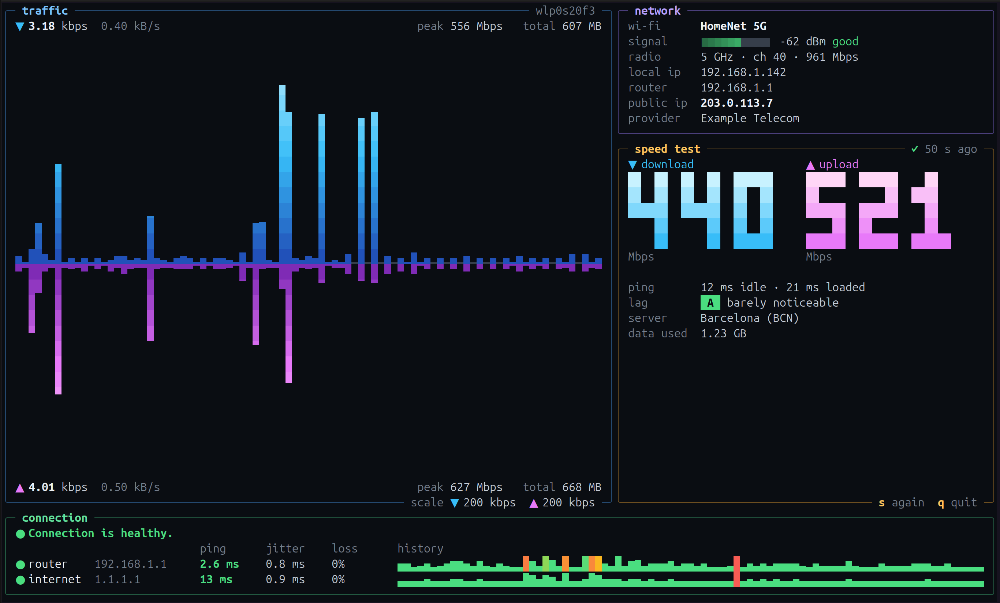

# netekg

Vital signs of your internet connection in one terminal screen.



- **Traffic:** live download and upload of the active interface
- **Connection:** ping, jitter and loss to your router and to the internet, and where the trouble is when there is some
- **Network:** Wi-Fi name, signal, band and channel, local and public IP, provider
- **Speed test:** download, upload and lag under load, graded from A+ to F

One small binary, no root needed. Linux, Windows and macOS.

## Install

Grab a binary from [Releases](https://github.com/karai32/netekg/releases) or build it with Rust:

```sh
cargo install --git https://github.com/karai32/netekg
```

On Windows, run it in Windows Terminal.

## Usage

```sh
netekg                  # the dashboard
netekg --speed          # speed test only
netekg --speed --json   # the same as JSON
```

Keys: `s` runs the speed test, `Esc` stops it, `q` quits.

The speed test runs against speed.cloudflare.com at full speed, so on a metered connection it uses a lot of data:
about 1.3 GB at 500 Mbps. Apart from that, netekg talks only to your router and 1.1.1.1.

## License

[GPL-3.0-or-later](LICENSE)
